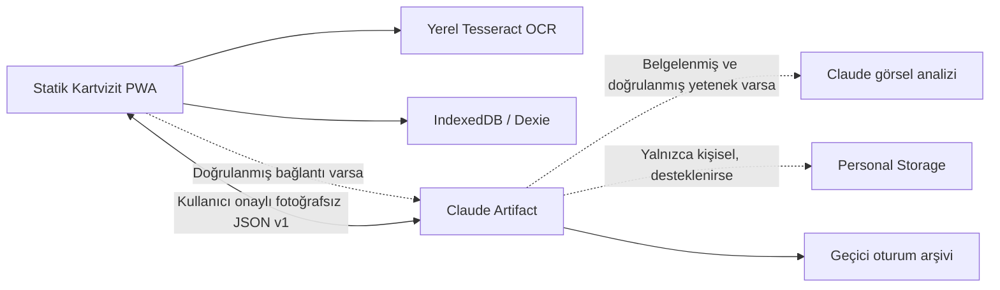

# Kartvizit mimarisi

PWA ve Artifact aynı kart şemasını, telefon normalizasyonunu ve aktarım motorunu kullanır. PWA kendi servis çalışanını, OCR worker'ını ve tam yerel yedeğini korur. Artifact paketi ayrı derlenir, Pages hizmetine dağıtılmaz. Üretim backend'i, otomatik eşitleme veya silme yayılımı yoktur. Çakışma kararları aktarım yazılırken IndexedDB işlemi içinde yeniden denetlenir.
